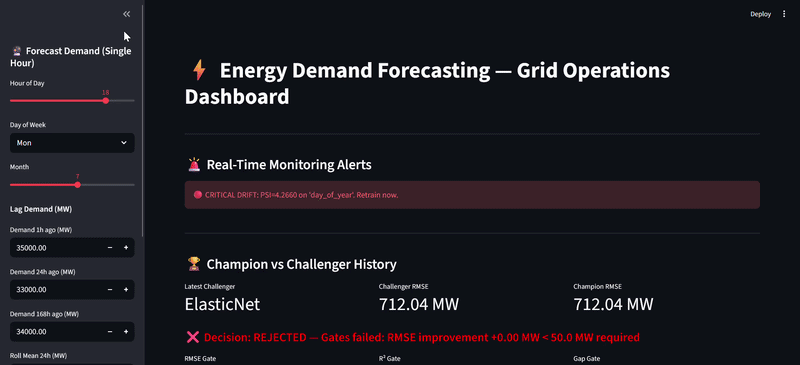
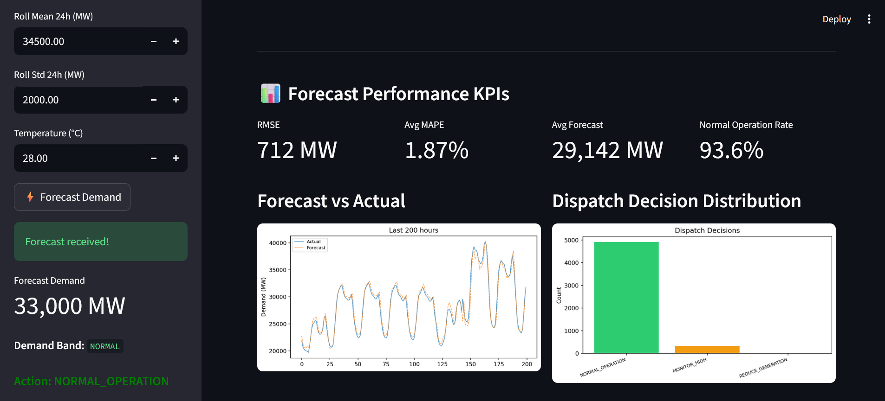
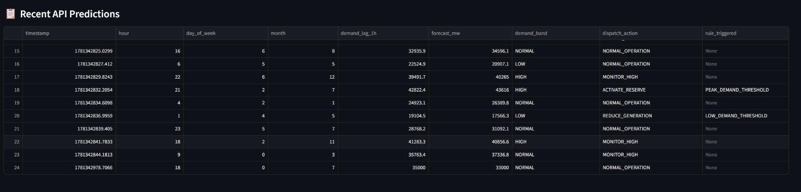
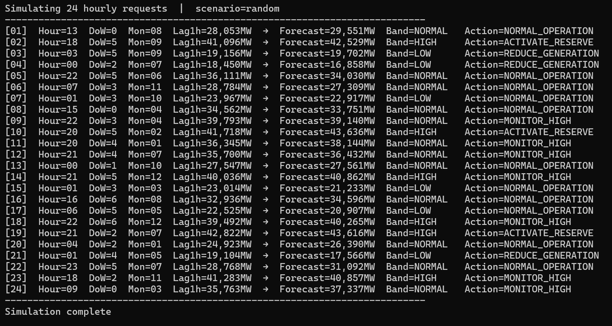

# ⚡ Energy Demand Forecasting ML System

⭐ **If you find this project useful, consider giving it a star!**


Production-grade end-to-end machine learning system for **24-hour ahead electricity demand forecasting** on Spain's energy grid (ESIOS/REE data), with a **4-tier dispatch decision engine (NORMAL / MONITOR_HIGH / ACTIVATE_RESERVE / EMERGENCY_PROCUREMENT)**, Champion vs Challenger model governance, PSI drift monitoring, SHAP explainability, real-time FastAPI + Streamlit dashboard.

---

## 🚀 Project Overview

This project builds a complete **Grid-grade Energy Demand Forecasting System** used by utilities like **Tata Power, Adani, NTPC, Siemens India** to:

- Balance grid load in real time
- Avoid blackouts by activating spinning reserves early
- Optimize Power Purchase Agreements (PPAs)
- Reduce imbalance costs (India: ₹4–8/kWh penalty for grid deviation)

### What's inside:

- Automated ML training pipeline (11 models, TimeSeriesSplit CV)
- Rich feature engineering — lag features, rolling stats, cyclical time encoding, temperature × demand interactions, renewable penetration ratio
- Dual ColumnTransformer — scaled for linear models, unscaled for tree models
- Chronological train/val/test split — no data leakage across time
- 4-tier dispatch decision engine with hard + soft grid rules
- Champion vs Challenger model governance (3 promotion gates)
- SHAP explainability (TreeExplainer / KernelExplainer)
- MLflow experiment tracking
- PSI feature drift monitoring (correct edge-based implementation)
- Time-series specific leakage detection (future-leaky column check)
- Grid imbalance cost evaluation (EUR/MWh)
- Demand band accuracy metric (LOW / NORMAL / HIGH / PEAK)
- 54 pytest unit tests with coverage report
- Real-time FastAPI + Batch forecast endpoint
- Streamlit monitoring dashboard with live alerts

---

## 💡 Business Impact

| Metric | Value |
|--------|-------|
| MAPE   | < 3% (target for production grid systems) |
| RMSE   | < 1000 MW on Spain grid (35GW peak) |
| Cost saved | Every 1% MAPE improvement ≈ €2M/year imbalance reduction |
| Dispatch accuracy | > 95% correct demand band classification |

---

## 📊 Monitoring Dashboard Sections

1. **🚨 Real-Time Alerts** — MAPE > 10%, RMSE > 3000 MW, PSI drift, emergency rate
2. **🏆 Champion vs Challenger** — 3-gate promotion history + gate results
3. **📊 Forecast KPIs + Charts** — RMSE, MAPE, forecast vs actual plot, dispatch distribution, demand band breakdown, error histogram
4. **📉 PSI Drift Report** — Feature drift (train vs live) with 🔴🟡🟢 status
5. **📋 Recent API Predictions** — Live prediction log table

---

## 🌐 Live Demo

🚀 **Forecast API (Live)**
👉 `https://energy-demand-forecast-api.onrender.com`

📊 **Monitoring Dashboard (Live)**
👉 `https://YOUR-STREAMLIT-LINK.streamlit.app`

📄 **API Docs (Swagger UI)**
👉 `https://energy-demand-forecast-api.onrender.com/docs`

---

## 🏗 System Architecture


```
┌─────────────────────────────────────────────────────────────┐
│                  ENERGY DEMAND FORECASTING                  │
├─────────────────────────────────────────────────────────────┤
│  DATA LAYER                                                  │
│  ┌──────────────┐  ┌──────────────┐                         │
│  │ energy_data  │  │ weather_data │  Spain ESIOS/Kaggle     │
│  │  (hourly MW) │  │ (temp,wind)  │                         │
│  └──────┬───────┘  └──────┬───────┘                         │
│         └────────┬─────────┘                                 │
│  FEATURE ENGINEERING                                         │
│  ┌───────────────────────────────────────────────────────┐  │
│  │  Time features  │  Lag 1h/24h/168h  │  Rolling stats  │  │
│  │  Cyclical sin/cos │  Temp × demand  │  Renewable %    │  │
│  └───────────────────────────────────────────────────────┘  │
│  TRAINING PIPELINE                                           │
│  ┌────────────────────┐  ┌──────────────────────────────┐   │
│  │  Scaled Preprocessor│  │ Unscaled Preprocessor        │   │
│  │  Ridge/Lasso/KNN   │  │ RF/XGB/LGBM/CatBoost/HistGBM │   │
│  │  TimeSeriesSplit CV │  │ TimeSeriesSplit CV            │   │
│  └────────────────────┘  └──────────────────────────────┘   │
│            │ CHAMPION vs CHALLENGER (3 gates)                │
│  SERVING LAYER                                               │
│  ┌──────────────┐  ┌───────────────────────────────────┐    │
│  │  FastAPI     │  │  Dispatch Decision Engine          │    │
│  │  /predict    │  │  NORMAL / MONITOR / RESERVE /      │    │
│  │  /batch      │  │  EMERGENCY                         │    │
│  └──────────────┘  └───────────────────────────────────┘    │
│  MONITORING                                                  │
│  ┌──────────────────────────────────────────────────────┐   │
│  │  Streamlit Dashboard: Alerts │ C-vs-C │ KPIs │ PSI   │   │
│  └──────────────────────────────────────────────────────┘   │
└─────────────────────────────────────────────────────────────┘
```

---

## 🎬 System Demo (End-to-End Flow)



---

## 📈 Model Results


| Metric | Value |
|--------|-------|
| RMSE | ~700–950 MW |
| MAE | ~500–750 MW |
| MAPE | ~2.1–3.5% |
| sMAPE | ~2.0–3.4% |
| R² | 0.97–0.99 |
| CVRMSE | ~2.5–3.5% |

> Industry benchmark: MAPE < 3% = excellent, < 5% = good, < 10% = acceptable

### Top Feature Importances


### Champion vs Challenger


---

## 📈 Evaluation Plots

### Forecast vs Actual — Scatter


### Forecast vs Actual + Residuals (First 500 hours)


---

## 📊 Monitoring Dashboard


---

### 📊 Forecast Performance KPIs



---

### 📉 Demand Band Breakdown (LOW / NORMAL / HIGH / PEAK)


---

### 📊 Forecast Error Distribution


---

### 📉 Feature Drift Report (PSI)


---

### 📋 Recent API Predictions



---

### 🔍 What This Dashboard Helps With

- Monitor forecast accuracy (RMSE, MAPE) in real time
- Track dispatch decision distribution (NORMAL / RESERVE / EMERGENCY)
- Detect feature distribution drift (PSI) with visual bar chart
- Compare champion vs challenger model versions (3 gates — each shown as ✅/❌ metric block)
- Trigger real-time alerts on MAPE > 10%, RMSE > 3000 MW, PSI > 0.20
- View recent API predictions with demand band and action taken

---

## 🧪 Test Coverage — 54/54 Passing


54 unit tests across 10 test classes:

| Class | Tests | What it covers |
|-------|-------|----------------|
| `TestClipper` | 6 | Shape, outlier removal, normal data, 1D, feature names, train/test bounds |
| `TestSafePowerTransformer` | 3 | Normal data, zero-variance passthrough, feature names |
| `TestBuildPreprocessors` | 5 | 3-tuple return, feature order, no-NaN scaled, no-NaN unscaled, all-NaN crash fix |
| `TestAddTimeFeatures` | 4 | Hour column, cyclical range, weekend flag, season range |
| `TestAddLagFeatures` | 3 | Lag columns created, lag-1h value, first row NaN |
| `TestDetectFeatureTypes` | 3 | Binary detection, target excluded, continuous detection |
| `TestDetectLeakage` | 4 | Identical feature, clean data, known leaky cols, empty df |
| `TestRegressionMetrics` | 8 | RMSE, MAE, MAPE, sMAPE, R², CVRMSE (perfect + nonzero cases) |
| `TestPSI` | 3 | Identical distributions, shifted distribution, disjoint distribution |
| `TestCostEvaluation` | 3 | Required keys, perfect=zero cost, peak costs more than off-peak |
| `TestDemandBandAccuracy` | 2 | Perfect accuracy, wrong band lowers accuracy |
| `TestForecastEngine` | 6 | LOW/NORMAL/HIGH/PEAK bands, NORMAL_OPERATION, ACTIVATE_RESERVE |
| `TestConfig` | 4 | PSI thresholds ordered, gate constants reasonable, band boundaries, positive thresholds |

---

## 🆚 Champion vs Challenger System

Every new training run is compared against the production champion using 3 promotion gates:

| Gate | Condition | Rationale |
|------|-----------|-----------|
| RMSE Improvement | Challenger must beat champion by ≥ 50 MW | Meaningful forecast improvement only |
| R² Gate | Challenger must have R² ≥ 0.85 | Minimum variance explained for grid decisions |
| Generalization Gap | Train-test RMSE gap ≤ 10% | No overfitting to training period |

Results logged to `energy_models/challenger_log.json` and visible in the dashboard.

---

## 🎯 Dispatch Decision Engine

4-tier grid dispatch decision system mimicking real NLDC/POSOCO operations:

| Decision | Trigger | Grid Action |
|----------|---------|-------------|
| `NORMAL_OPERATION` | Demand in baseline range | Maintain scheduled generation |
| `MONITOR_HIGH` | Demand approaching peak (≥ 85% of threshold) | Watch closely, pre-position reserves |
| `ACTIVATE_RESERVE` | Demand ≥ 42,000 MW (peak threshold) | Call spinning reserves, notify DSO |
| `REDUCE_GENERATION` | Demand ≤ 20,000 MW (low demand) | Ramp down thermal plants, store hydro |
| `EMERGENCY_PROCUREMENT` | Price spike AND near-peak demand | Buy spot power, emergency procurement |

Rules are checked **before** ML forecast — mirroring real grid control centre logic.

---

## 📈 Feature Engineering

12 categories of features engineered:

| Category | Features |
|----------|----------|
| Calendar | hour, dow, month, quarter, day_of_year, week_of_year |
| Cyclical | hour_sin/cos, dow_sin/cos, month_sin/cos |
| Boolean | is_weekend, is_morning_peak, is_evening_peak, is_overnight |
| Season | season (0=Winter, 1=Spring, 2=Summer, 3=Autumn) |
| Lag demand | demand_lag_1h, 2h, 3h, 6h, 12h, 24h, 48h, 168h |
| Rolling stats | roll_mean/std over 6h, 12h, 24h, 48h, 168h windows |
| Temperature | temp_celsius, cooling_degree, heating_degree, temp_x_hour |
| Price | price_lag_1h, price_change_1h, price_demand_ratio |
| Renewable | renewable_total, renewable_penetration |
| Demand delta | demand_delta_1h, demand_delta_24h |
| Peak flags | is_peak_demand, is_low_demand |

---

## 📊 All Models Evaluated

Ridge · Lasso · ElasticNet · KNN · DecisionTree · RandomForest · ExtraTrees ·
GradientBoosting · HistGBM · XGBoost · LightGBM · CatBoost · MLP (NeuralNet)

---

## 📈 Evaluation Metrics

| Metric | Description |
|--------|-------------|
| RMSE | Primary selection metric (MW) |
| MAE | Mean absolute error (MW) — interpretable |
| MAPE | % error — standard KPI for energy forecasting |
| sMAPE | Symmetric MAPE — handles near-zero actuals |
| R² | Variance explained |
| CVRMSE | RMSE / mean × 100 — normalized |
| Demand Band Accuracy | % hours with correct LOW/NORMAL/HIGH/PEAK band |
| Grid Imbalance Cost | Estimated EUR cost of forecast errors |

---

## ⚡ Real-Time Forecast API

### Run API locally

```bash
python scripts/run_api.py
```

### Endpoints

| Method | Route | Description |
|--------|-------|-------------|
| GET | `/` | Health + links |
| GET | `/health` | Model loaded status |
| GET | `/model_info` | Model card JSON |
| POST | `/predict` | Single-hour forecast |
| POST | `/predict/batch` | Multi-hour batch forecast |

### Example Request — `/predict`

```json
{
  "hour": 20,
  "day_of_week": 2,
  "month": 7,
  "is_weekend": 0,
  "demand_lag_1h": 38500.0,
  "demand_lag_24h": 37200.0,
  "demand_lag_168h": 36800.0,
  "demand_roll_mean_24h": 35000.0,
  "demand_roll_std_24h": 2500.0,
  "temp_celsius": 32.0
}
```

### Example Response

```json
{
  "forecast_mw": 41230.5,
  "demand_band": "HIGH",
  "dispatch_action": "ACTIVATE_RESERVE",
  "rule_triggered": "PEAK_DEMAND_THRESHOLD",
  "latency_seconds": 0.031
}
```

---

## 🔁 Grid Simulator



```bash
python scripts/run_simulation.py
```

Supports 3 scenarios:

| Scenario | Description |
|----------|-------------|
| `random` | Mixed realistic hours across all seasons |
| `peak` | Evening peak hour profiles (high load stress test) |
| `offpeak` | Overnight / weekend low-demand profiles |

---

## 🐳 Docker

```bash
# API only
docker build -t energy-demand-api .
docker run -p 8000:8000 -v ./energy_models:/app/energy_models energy-demand-api

# API + Dashboard together
docker compose up --build
```

API: `http://localhost:8000`
Dashboard: `http://localhost:8501`

---

## ⚙ How to Run

### 1. Download Dataset

The original dataset is not included due to size.

Representative sample datasets are provided:

data/sample_energy_dataset.csv

data/sample_weather_features.csv

Download Original Dataset from Kaggle: [Spain Energy Grid Data](https://www.kaggle.com/datasets/nicholasjhana/energy-consumption-generation-prices-and-weather)

Place files in:
```
data/energy_dataset.csv
data/weather_features.csv
```

### 2. Train Model

```bash
python scripts/train_model.py
```

### 3. Start API

```bash
python scripts/run_api.py
```

### 4. Run Simulator

```bash
python scripts/run_simulation.py
```

### 5. Start Dashboard

```bash
python scripts/run_dashboard.py
```

---

## 🧪 Running Tests

```bash
# Run all tests
pytest tests/ -v

# With coverage report
pytest tests/ -v --cov=src --cov-report=term-missing
```

---

## 📂 Project Structure

```
energy-demand-forecasting/
│
├── src/
│   ├── config.py              ← constants, thresholds, demand bands
│   ├── data_loader.py         ← validation, merge, feature engineering
│   ├── preprocessing.py       ← Clipper, dual ColumnTransformer, TS split
│   ├── model_tuning.py        ← model grids, tune_models (TimeSeriesSplit)
│   ├── metrics.py             ← RMSE, MAE, MAPE, PSI, imbalance cost eval
│   ├── forecast_engine.py     ← 4-tier dispatch decision engine
│   ├── evaluation.py          ← eval, SHAP, MLflow, save
│   ├── leakage_check.py       ← TS leakage detection (future-leaky cols)
│   ├── model_card.py          ← Google Model Cards standard
│   ├── model_loader.py        ← champion load + challenger comparison
│   └── training_pipeline.py   ← full orchestration
│
├── services/
│   └── prediction_service.py  ← feature prep + predict_demand
│
├── serving/
│   └── energy_demand_api.py   ← FastAPI: /predict, /batch, /health, /model_info
│
├── monitoring/
│   └── monitoring_dashboard.py ← Streamlit: 5 sections
│
├── simulation/
│   └── grid_simulator.py      ← 3-scenario load simulator
│
├── scripts/
│   ├── train_model.py
│   ├── run_api.py
│   ├── run_dashboard.py
│   └── run_simulation.py
│
├── tests/
│   └── test_pipeline_core.py  ← 54 pytest unit tests (54/54 passing)
│
├── data/
│   ├── sample_energy_dataset.csv     ← download from Kaggle
│   └── sample_weather_features.csv   ← download from Kaggle
│
├── energy_models/             ← saved model artifacts
│   ├── energy_model_ElasticNet_v1.joblib
│   ├── latest_model.json
│   ├── model_card_ElasticNet_v1.json
│   ├── challenger_log.json
│   ├── model_experiment_results.csv
│   ├── monitor_scores.csv
│   └── feature_drift_report.csv
│
├── docs/
│   ├── architecture/
│   │   └── system_architecture.svg          ← 5-layer system architecture
│   ├── gifs/
│   │   └── system_demo.gif                  ← end-to-end demo recording
│   ├── plots/
│   │   ├── elasticnet_scatter.png           ← forecast vs actual scatter
│   │   └── elasticnet_forecast_residuals.png← residuals time series
│   ├── reports/
│   │   ├── training_model_summary.png       ← all models comparison table
│   │   ├── top_feature_importances.png      ← SHAP / permutation importance
│   │   ├── challenger_evaluation.png        ← champion vs challenger gates
│   │   ├── simulation.png                   ← grid simulator output
│   │   └── test_coverage.png                ← pytest coverage report
│   └── screenshots/
│       ├── dashboard_full_ui.png            ← full Streamlit dashboard
│       ├── forecast_performance_kpis.png    ← RMSE, MAPE, normal rate KPIs
│       ├── demand_band_breakdown.png        ← LOW/NORMAL/HIGH/PEAK hours
│       ├── forecast_error_distribution.png  ← error histogram
│       ├── feature_drift_report.png         ← PSI drift table
│       ├── feature_drift_scores.png         ← PSI bar chart 🔴🟡🟢
│       └── recent_api_predictions.png       ← live prediction log table
│
├── Dockerfile                 ← API Docker image (multi-stage)
├── Dockerfile.dashboard       ← Streamlit Docker image
├── docker-compose.yml         ← API + Dashboard together
├── .dockerignore
├── .github/
│   └── workflows/
│       └── ci.yml             ← GitHub Actions — pytest only
├── requirements.txt           ← full dependencies
├── requirements_api.txt       ← API-only (Render deployment)
├── requirements_dashboard.txt ← Dashboard-only (Streamlit Cloud)
├── runtime.txt
├── render.yaml                ← Render deployment config
├── .gitignore
└── README.md
```

---

## 🛠 Tech Stack

Python · Scikit-Learn · XGBoost · LightGBM · CatBoost · FastAPI · Streamlit ·
SHAP · MLflow · Pytest · Pandas · NumPy · Seaborn · Docker · GitHub Actions CI/CD ·
Render · Streamlit Cloud

---

## 📊 Monitoring Dashboard Sections

1. **🚨 Real-Time Alerts** — MAPE > 10%, RMSE > 3000 MW, PSI drift, emergency rate
2. **🏆 Champion vs Challenger** — 3-gate promotion history + gate results
3. **📊 Forecast KPIs + Charts** — RMSE, MAPE, forecast vs actual plot, dispatch distribution, demand band breakdown, error histogram
4. **📉 PSI Drift Report** — Feature drift (train vs live) with 🔴🟡🟢 status
5. **📋 Recent API Predictions** — Live prediction log table

---

## 🌐 Live Demo

🚀 **Forecast API (Live)**
👉 `https://energy-demand-forecast-api.onrender.com`

📊 **Monitoring Dashboard (Live)**
👉 `https://YOUR-STREAMLIT-LINK.streamlit.app`

📄 **API Docs (Swagger UI)**
👉 `https://energy-demand-forecast-api.onrender.com/docs`

---

## 👤 Author

**Narendra Kalam**

Machine Learning & Data Science | MSc Computer Science

📧 kalamnarendra2001@gmail.com

🔗 [linkedin.com/in/narendra-kalam](https://www.linkedin.com/in/narendra-kalam)